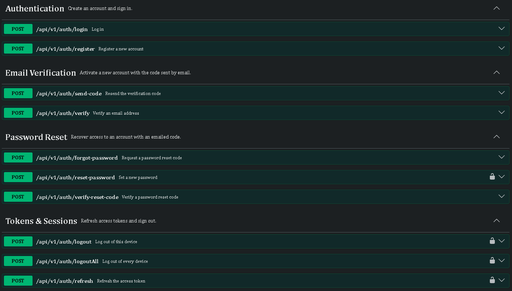
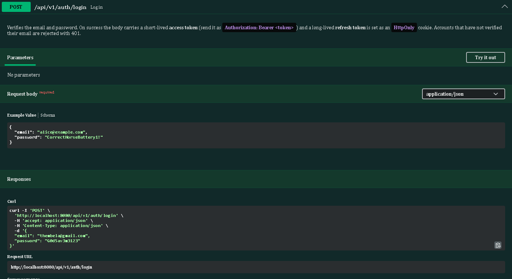
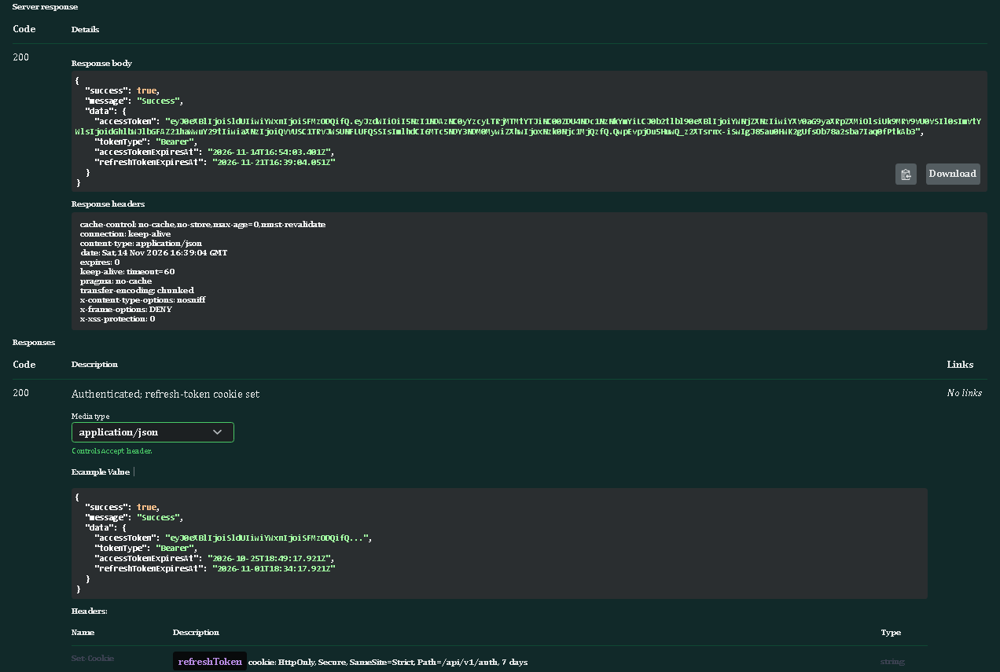
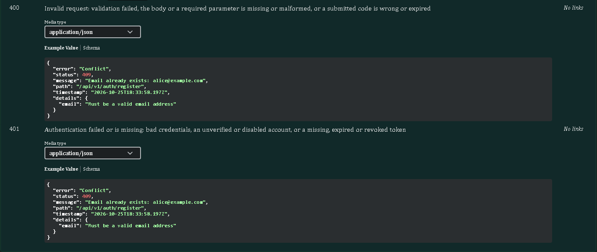
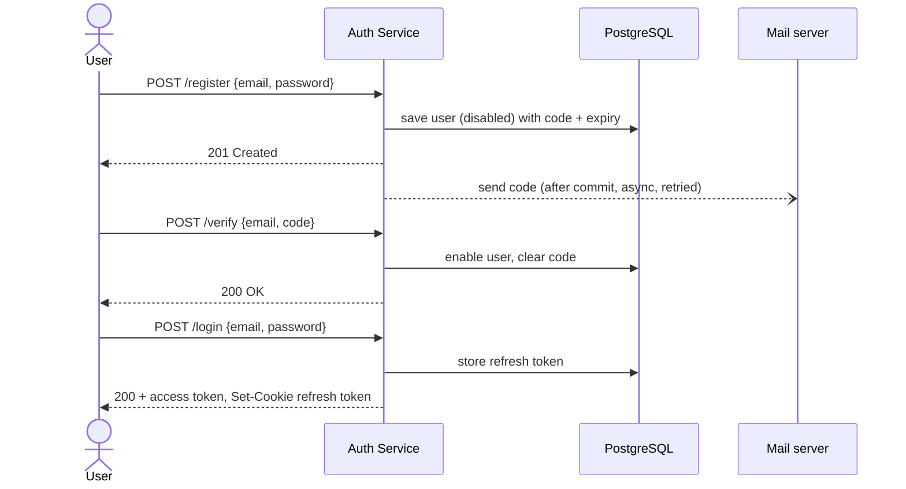
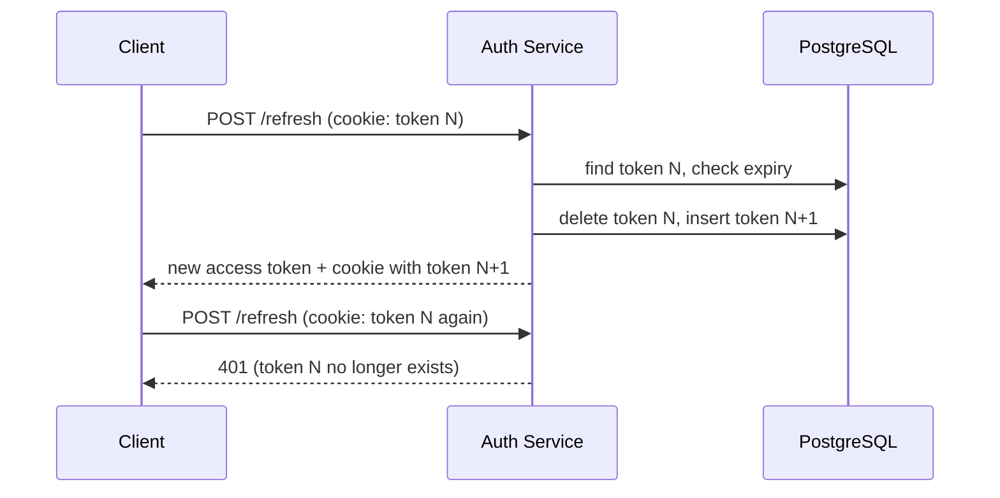
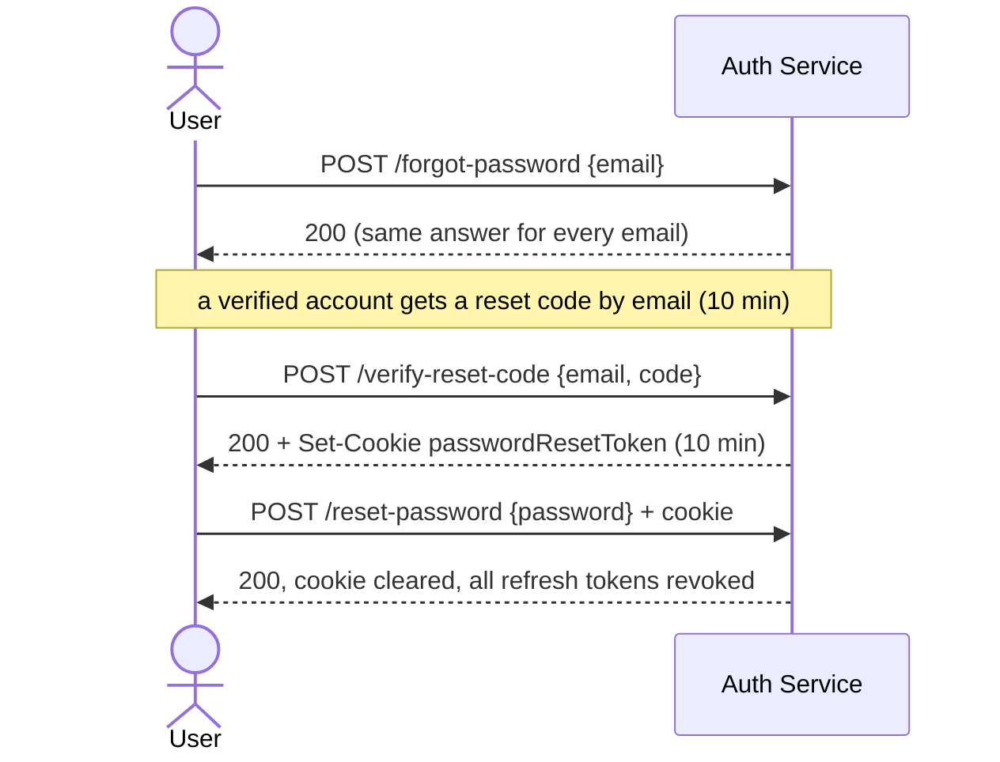

# TeeGate Auth Service

A stateless authentication service built with **Spring Boot 4**, **Spring Security 7** and **PostgreSQL**.
It covers the full account lifecycle: registration with email verification, JWT login, refresh-token
rotation, logout (one device or all), and password reset, all behind a documented REST API.

<p align="center">
  
  
  
  
</p>

<p align="center">
  
</p>

## Features

- **Registration with email verification**: accounts start disabled and are activated with a 6-digit code (valid 15 minutes, resend cooldown of 2 minutes).
- **JWT authentication**: short-lived access tokens (15 minutes by default) carried in the `Authorization` header and validated without a database call on each request.
- **Refresh-token rotation**: refresh tokens live in an `HttpOnly`, `Secure`, `SameSite=Strict` cookie, are stored server-side, and are replaced on every use, so replaying an old one fails.
- **Logout**: revoke the current device's token, or every token of the account.
- **Password reset** with an emailed code and a short-lived reset cookie. It does not reveal whether an email is registered, and it signs the user out everywhere when the password changes.
- **Reliable email delivery**: codes are sent asynchronously after the database commit and retried on transient SMTP failures.
- **Housekeeping**: a scheduled job purges expired refresh tokens daily.
- **One error format** for every failure, plus interactive API docs (Swagger UI).

## Tech stack

| Area | Technology |
|---|---|
| Language / runtime | Java 21 |
| Framework | Spring Boot 4.0.6 (Spring Framework 7, Spring Security 7) |
| Persistence | Spring Data JPA, Hibernate 7, PostgreSQL 18 |
| Migrations | Flyway (Hibernate runs in `validate` mode) |
| Tokens | JJWT 0.13.0 (HMAC-signed JWTs) |
| Email | Spring Mail, Thymeleaf HTML templates, Mailpit for local development |
| API docs | springdoc-openapi 3.x (Swagger UI, OpenAPI 3.1) |
| Packaging | Multi-stage Dockerfile (Maven 3.9 build, Temurin 21 JRE on Alpine, non-root user), Docker Compose |

## Quick start (Docker)

Requirements: Docker with Compose v2.

```bash
git clone https://github.com/TeeThembela/Auth-Service.git
cd <Auth-Service>

# 1. Create your environment file
cp .env.example .env            # PowerShell: Copy-Item .env.example .env

# 2. Generate a JWT secret and paste it into .env as JWT_SECRET_KEY
openssl rand -base64 32

# 3. Build and start everything
docker compose up --build
```

The first build downloads dependencies, so give it a few minutes. When it is up:

| What | URL |
|---|---|
| API | http://localhost:8080 |
| Swagger UI | http://localhost:8080/swagger-ui.html |
| Mailpit (captured emails) | http://localhost:8025 |
| PostgreSQL (for a DB client) | `localhost:5434` |

The stack is three containers: the API, PostgreSQL 18 (data kept in a named volume), and
[Mailpit](https://github.com/axllent/mailpit), which catches outgoing email so you can read the
verification codes without any real SMTP credentials. Flyway creates the schema and seeds the
`ROLE_USER` role on first start.

### Try it in Swagger UI

1. `POST /api/v1/auth/register` with an email and a password of at least 12 characters.
2. Open Mailpit at http://localhost:8025 and copy the 6-digit code.
3. `POST /api/v1/auth/verify` with the email and code.
4. `POST /api/v1/auth/login`, then copy `data.accessToken` from the response.
5. Click **Authorize**, paste the token, and call `POST /api/v1/auth/logoutAll` (expect `204`).

Refresh and logout use the refresh-token cookie that login sets; the browser sends it for you.
Because the cookies are `Secure`, use `http://localhost` (browsers allow it) or HTTPS.

<p align="center">
  
</p>

<p align="center">
  
</p>

<p align="center">
  
</p>

Stop the stack with `docker compose down`. Add `-v` to also delete the database volume.

## API overview

Base path: `/api/v1/auth`. Full request and response details, examples and error cases are in Swagger UI
(OpenAPI JSON at `/v3/api-docs`).

| Method | Path | Authentication | Purpose |
|---|---|---|---|
| POST | `/register` | none | Create an unverified account and email a code |
| POST | `/verify` | none | Verify the email with the 6-digit code |
| POST | `/send-code?email=` | none | Resend the verification code |
| POST | `/login` | none | Returns an access token and sets the refresh cookie |
| POST | `/refresh` | refresh cookie | Rotate the refresh token and issue a new access token |
| POST | `/logout` | refresh cookie | Revoke this device's refresh token |
| POST | `/logoutAll` | Bearer access token | Revoke every refresh token of the account |
| POST | `/forgot-password` | none | Email a reset code (always answers 200) |
| POST | `/verify-reset-code` | none | Exchange the code for a short-lived reset cookie |
| POST | `/reset-password` | reset cookie | Set a new password and revoke all sessions |

Every response uses one of two shapes: a success envelope
(`{ "success": true, "message": "...", "data": ... }`) or an error body
(`error`, `status`, `message`, `path`, `timestamp`, optional `details`).

## How it works

### Register, verify, log in



### Refresh-token rotation



### Password reset



## Design decisions

| Decision | Why |
|---|---|
| Access tokens are validated from their claims only | No database lookup per request, so protected endpoints stay stateless and cheap. |
| Refresh tokens are stored server-side and rotated on every use | Gives real revocation (logout, logout-all, password reset) and detects replay of old tokens. |
| A `token_type` claim (`access`, `refresh`, `password_reset`) | A token issued for one purpose cannot be accepted for another. |
| Refresh and reset tokens travel in `HttpOnly`, `Secure`, `SameSite=Strict` cookies | They are out of reach of JavaScript (XSS) and are not sent cross-site. |
| Reset flow answers identically for known and unknown emails | Prevents using the endpoints to discover which accounts exist. |
| Verification and reset codes come from `SecureRandom`, expire, and are cleared after use | Codes are unpredictable and short-lived. |
| Email is sent after the transaction commits, asynchronously, with retries | An SMTP failure never rolls back a registration, and a rolled-back registration never sends a code. |
| Flyway migrations with Hibernate `ddl-auto: validate` | The schema is versioned and reproducible; the app refuses to start if the entities and schema disagree. |
| JWT settings are validated at startup | The app fails fast on a missing or too-short secret, a blank issuer, or non-positive lifetimes. |
| Secrets come from environment variables | Nothing sensitive is committed or baked into the image. |
| Sensitive DTO fields are masked in `toString()` | Passwords, codes and tokens cannot leak into logs. |

## Configuration

All settings are environment variables (see `.env.example`).

| Variable | Description | Default / example |
|---|---|---|
| `DB_HOST`, `DB_PORT`, `DB_NAME` | PostgreSQL location | `localhost`, `5433`, your database name |
| `DB_USERNAME`, `DB_PASSWORD` | PostgreSQL credentials | none |
| `JWT_SECRET_KEY` | Base64 secret, at least 32 bytes once decoded | `openssl rand -base64 32` |
| `JWT_ISSUER` | `iss` claim value | `auth-service` |
| `JWT_ACCESS_EXPIRATION` | Access token lifetime (ms) | `900000` (15 min) |
| `JWT_REFRESH_EXPIRATION` | Refresh token lifetime (ms) | `604800000` (7 days) |
| `JWT_PASSWORD_RESET_EXPIRATION` | Reset token lifetime (ms) | `600000` (10 min) |
| `MAIL_SENDER` | From address on outgoing mail | `no-reply@teegate.local` |
| `MAIL_USERNAME`, `MAIL_APP_PASSWORD` | SMTP credentials (ignored by Mailpit) | none |
| `RT_CLEANUP_CRON` | Schedule for purging expired refresh tokens | `0 0 2 * * *` (daily 02:00) |
| `SPRINGDOC_API_DOCS_ENABLED`, `SPRINGDOC_SWAGGER_UI_ENABLED` | Turn the API docs on or off together | `true` |

Under Docker Compose the `docker` profile points the app at the Postgres and Mailpit containers.
To send real email, set the `MAIL_*` variables for your SMTP provider and adjust the mail host and
TLS settings in `application-docker.yaml`.

## Project structure

```
src/main/java/com/teetech/authservice
├── config/        security, async, retry, scheduler and OpenAPI configuration
├── controller/    AuthController (the REST endpoints)
├── docs/          reusable OpenAPI error annotations
├── dto/           request/response records (auth, common, error, event, token)
├── entity/        JPA entities: User, Authority, RefreshToken
├── exception/     domain exceptions and the global exception handler
├── listener/      after-commit email listener
├── repository/    Spring Data repositories
├── scheduler/     expired refresh-token cleanup job
├── security/      JWT filter, handlers, UserDetails adapter
├── service/       AuthService, EmailService and their implementations
└── util/          JwtUtil, JwtProperties, constants
src/main/resources
├── db/migration/  Flyway scripts (V1 schema, V2 seed)
└── templates/email/  Thymeleaf email templates
```

## Local development without Docker

You need Java 21, Maven and a PostgreSQL instance. Export the variables from `.env.example`
(or put them in a gitignored `application-local.yaml`; the `local` profile is active by default),
then run:

```bash
mvn spring-boot:run
```

A convenient setup is to start only the supporting services with
`docker compose up db-postgres mailpit` and run the API from your IDE.

## Known limitations and roadmap

This is a focused auth service, and these gaps are known:

- **No rate limiting yet.** Login, code and reset endpoints are not throttled, so do not expose this publicly as is. A two-tier design (per-IP filter plus per-account limits) is planned.
- **Automated tests are planned** (unit tests and integration tests against a real PostgreSQL container). The API was verified with a manual test matrix covering every endpoint and edge case.
- **Refresh tokens are stored as issued.** Hashing them at rest is a planned hardening.
- **Access tokens cannot be revoked before they expire** (15 minutes by default); that is the trade-off of stateless validation.
- **Registration, resend and verify reveal whether an email is registered**, which signup flows usually need. The password-reset endpoints do not.
- **HMAC signing** means every verifier needs the secret. Moving to asymmetric keys (RS256 with a JWKS endpoint) would suit a multi-service setup.
- **Swagger UI is on by default.** Turn it off with the `SPRINGDOC_*` variables outside local use.

Also planned: a GitHub Actions build, and MFA or social login if the service grows.

## Author

Built by [TeeThembela](https://github.com/TeeThembela). Feedback and questions are welcome.

<br/>
